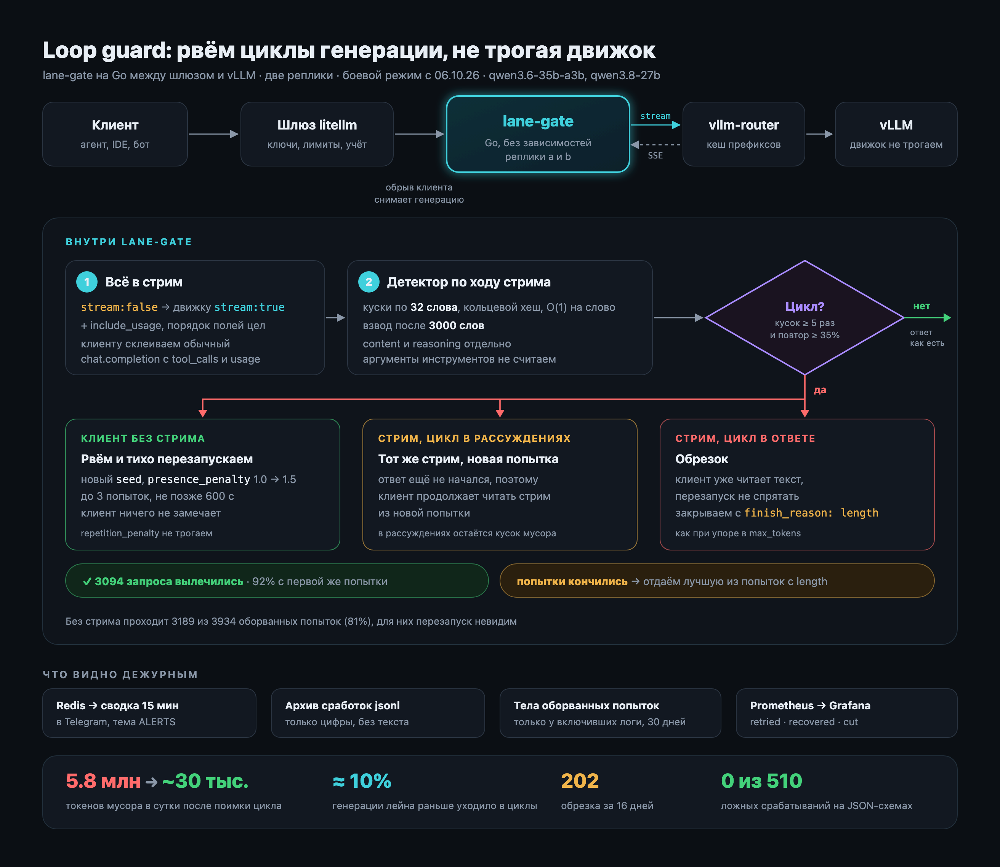

# loop-gate

Скилл для Claude Code и Codex: как поставить перед своими LLM-движками гейт,
который ловит зацикленную генерацию и перезапускает запрос, не трогая движок.



Схема в векторе: [`docs/scheme.html`](docs/scheme.html).

Внутри:
- `skills/loop-gate/SKILL.md` — пошагово: принудительный стрим, детектор,
  калибровка, боевой режим, метрики, что это портит;
- `skills/loop-gate/reference/detector.go` — детектор N-граммных повторов по ходу стрима;
- `skills/loop-gate/reference/trim.go` — срез зацикленного хвоста для обрезка;
- `skills/loop-gate/reference/calibrate.py` — подбор порога по вашим логам.

Установка:

```bash
git clone https://github.com/vakovalskii/loop-gate-skill
cp -r loop-gate-skill/skills/loop-gate ~/.claude/skills/   # Claude Code
cp -r loop-gate-skill/skills/loop-gate ~/.codex/skills/    # Codex
```

Дальше просто попросите агента: «поставь loop-gate перед моим vLLM».

Работает в проде [NeuralDeep](https://neuraldeep.ru) с октября 2026 на Qwen 3.6 и 3.8.
